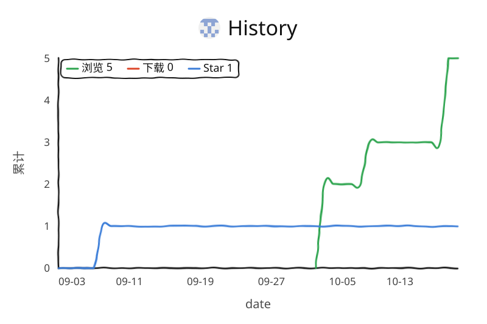

# imgsearch

一个跑在自己机器上的图片搜索工具。给它一个文件夹，它就能让你用**图片**或者**一句话**去搜。

不上传、不联网（除了第一次下模型），索引就放在本地。

- 丢一张图进去 → 找相似的
- 打一句「海边的日落」→ 也能找出来
- 中文、英文、日文、韩文都能直接搜，不用先翻译

## 为什么是它

- **真的是本地**：图片不出机器，索引在 `~/.imgsearch/`
- **增量索引**：只处理新增和改动的图，删掉的会自动从索引里剔除
- **格式管够**：JPG、PNG、HEIC、PSD、WEBP 等 20 多种
- **内置轻量模型**：最小版本自带 ViT-B-32（约 340MB），开箱就能用
- **国内友好**：自动检测并使用 HuggingFace 镜像

## 跑起来

### 方式一：Docker 一行命令（推荐）

```bash
docker run -d \
  --name imgsearch \
  -p 57860:57860 \
  -v /你的图片路径:/library:ro \
  -v imgsearch-data:/root/.imgsearch \
  -e HF_ENDPOINT=https://hf-mirror.com \
  ghcr.io/ccrichard3/imgsearch:minimal
```

然后打开 `http://localhost:57860`。

### 方式二：docker compose

```bash
curl -O https://raw.githubusercontent.com/ccrichard3/imgsearch/main/docker-compose.minimal.yml
vim docker-compose.minimal.yml   # 把 - /你的图片路径:/library:ro 改掉
docker-compose -f docker-compose.minimal.yml up -d
```

### 方式三：NAS 一键部署

```bash
curl -fsSL https://raw.githubusercontent.com/ccrichard3/imgsearch/main/deploy_nas_minimal.sh | bash
```

### 方式四：直接下可执行文件

不想装 Python 的话，去 [Releases](https://github.com/ccrichard3/imgsearch/releases) 下对应平台的包：

| 平台 | 文件 |
|---|---|
| macOS (Apple Silicon) | `imgsearch-minimal-Darwin-arm64.tar.gz` |
| macOS (Intel) | `imgsearch-minimal-Darwin-x86_64.tar.gz` |
| Linux (x86_64) | `imgsearch-minimal-Linux-x86_64.tar.gz` |
| Windows (x64) | `imgsearch-minimal-Windows-x86_64.zip` |

解压后直接跑 `./imgsearch-minimal`（Windows 是 `imgsearch-minimal.exe`）。

## 模型怎么选

内置的 ViT-B-32 够快够轻，日常用没问题。想要更准的可以换：

| 模型 | 大小 | 速度 | 质量 | 适合 |
|---|---|---|---|---|
| **ViT-B-32** ⭐ | ~340MB | 最快 | 良好 | 日常（已内置） |
| **ViT-B-16-SigLIP2-256** 🔥 | ~350MB | 快 | 优秀 | 多语言场景，推荐 |
| **ViT-L-16-SigLIP2-384** | ~1.2GB | 中 | 很强 | 要高精度 |
| **ViT-SO400M-16-SigLIP2-384** | ~1.8GB | 慢 | 最强 | 专业用途 |
| **ViT-L-14** | ~890MB | 中 | 优秀 | CLIP 经典，英文强 |

换模型最简单的办法是打开网页点「设置」，选一个，它会自己下（国内自动走镜像）。

模型缓存放在：

- macOS / Linux：`~/.cache/huggingface/hub/`
- Windows：`%USERPROFILE%\.cache\huggingface\hub\`
- Docker：`huggingface-cache` 这个 volume

想给离线机器用，把这个目录整个拷过去就行。

## 数据在哪

- 索引：`~/.imgsearch/cache__<模型名>.pkl`
- 缩略图：`~/.imgsearch/thumbs/`
- 配置：`~/.imgsearch/config.json`

删掉 `~/.imgsearch/` 就等于清空重建。

## 常见问题

**第一次启动很慢？**
内置模型已经打包进去了，启动是秒开的。只有切换别的模型时才需要联网下一次。

**模型下不下来？**
国内记得设 `HF_ENDPOINT=https://hf-mirror.com`。

**端口冲突？**
改映射就行，比如 `-p 8080:57860`。

**镜像拉取慢？**

```bash
sudo mkdir -p /etc/docker
sudo tee /etc/docker/daemon.json <<EOF
{
  "registry-mirrors": ["https://docker.mirrors.ustc.edu.cn"]
}
EOF
sudo systemctl restart docker
```

## 性能大概什么样

索引 1 万张图：

- Apple Silicon (MPS)：约 5 分钟
- Linux + NVIDIA GPU：约 8 分钟
- NAS (Intel CPU)：约 20 分钟
- Windows (CPU)：约 15 分钟

搜索响应：MPS 约 0.5 秒，CUDA 约 0.8 秒，纯 CPU 约 2 秒。

## 自己构建

```bash
git clone https://github.com/ccrichard3/imgsearch.git
cd imgsearch
./build_minimal.sh          # 产物在 dist/imgsearch-minimal/，约 2GB
```

Docker 镜像：

```bash
docker build -f Dockerfile.minimal -t imgsearch:minimal .
docker tag imgsearch:minimal ghcr.io/ccrichard3/imgsearch:minimal
docker push ghcr.io/ccrichard3/imgsearch:minimal
```

## 相关链接

- [快速上手](./QUICK_START.md)
- [Windows 部署](./releases/windows/DEPLOY_WINDOWS.md)
- [部署指南](./DEPLOY.md)
- [模型详细说明](./MODELS.md)

## 许可证

MIT

## 致谢

- [OpenCLIP](https://github.com/mlfoundations/open_clip) —— CLIP 模型实现
- [HuggingFace](https://huggingface.co/) —— 模型托管
- [hf-mirror.com](https://hf-mirror.com/) —— 国内镜像加速

## 使用趋势

<picture>
  <source media="(prefers-color-scheme: dark)" srcset="traffic/views-dark.svg" />
  <source media="(prefers-color-scheme: light)" srcset="traffic/views.svg" />
  
</picture>
